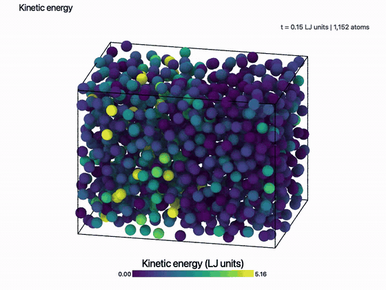
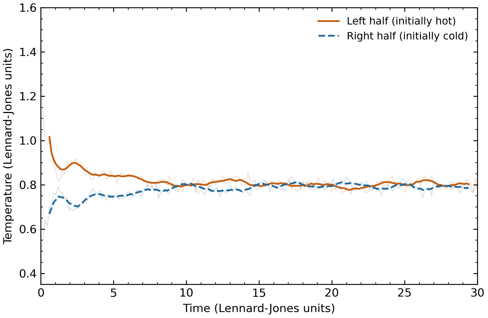
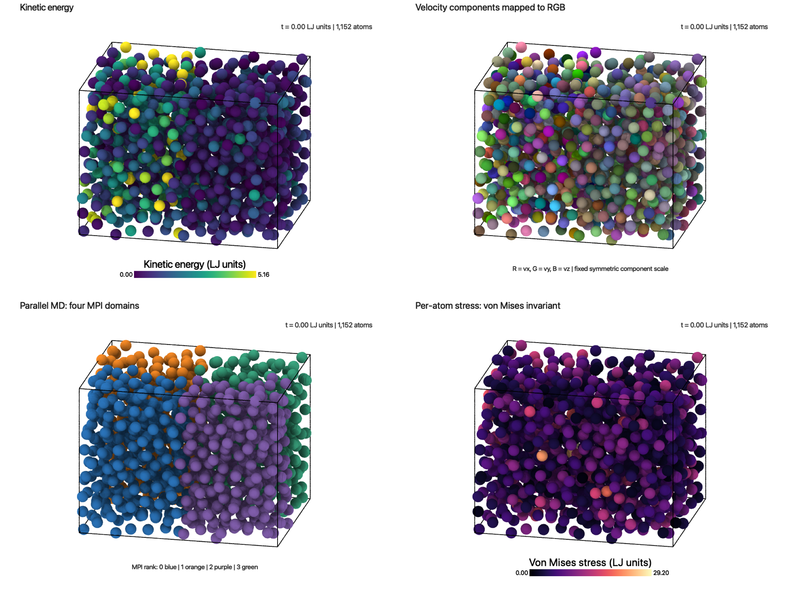

# Visualizing thermal equilibration in parallel molecular dynamics

**Daniela Dantas Quintana · CSCI 596 · Fall 2026**

Hot and cold regions of a simulated fluid approach a common temperature. Four complementary views connect that relaxation to atomic kinetic energy, velocity components, MPI ownership, and stress.

**[Methods and results](docs/METHODS_AND_RESULTS.md)** · **[Reproduce](#reproduce)**

## Problem

How does an initially nonuniform temperature field relax, and how can visualization reveal the physical quantities behind the atoms' motion?

## Method

I extended the class `pmd.c` program to simulate **1,152 Lennard-Jones atoms with four MPI ranks**. The left spatial half starts at temperature **1.5** and the right at **0.5**, in reduced units. After this one-time initialization, the system evolves without a thermostat. OVITO displays four different encodings of the same trajectory.

| Thermal equilibration animation | Measured temperatures |
|---|---|
|  |  |

## Results

- Over reduced time **20–30**, the two spatial halves average **0.800 and 0.793**, compared with initial values of 1.5 and 0.5.
- Maximum total-energy deviation is **0.0128%** of the initial energy magnitude.
- Independent all-pairs calculations reproduce the exported stress components to within **1.8 × 10⁻⁸** at the three checked frames.

The result is a reproducible connection between parallel simulation, measured thermal relaxation, and physical-property visualization. This single finite-system run demonstrates equilibration; it does not measure thermal conductivity or parallel speedup.

### Four views of the same run



| View | What the colors mean | Full movie |
|---|---|---|
| Kinetic energy | Per-atom energy; one fixed color scale throughout the run | [Play/download](movies/kinetic_energy.mp4) |
| Velocity RGB | Red, green, blue encode the signed x, y, z velocity components | [Play/download](movies/velocity_rgb.mp4) |
| Parallel domains | Current owner among the four MPI ranks | [Play/download](movies/parallel_domains.mp4) |
| Stress | Von Mises invariant of the per-atom stress tensor | [Play/download](movies/stress_von_mises.mp4) |

All movies contain **201 frames**, run for **10.05 seconds**, and use **960 × 720** resolution.

The [six independent stress components](figures/stress_tensor_components.png) and [spatial temperature profile](figures/temperature_profile.png) provide additional views. All parameters, formulas, color bounds, and interpretation limits are in the [full report](docs/METHODS_AND_RESULTS.md).

## What I added to the class code

1. A hot/cold initialization with the mean velocity removed separately in each spatial half.
2. Persistent atom identifiers that survive MPI migration.
3. Kinetic-energy and symmetric stress-tensor export alongside positions, velocities, and current MPI owner.
4. Independent numerical checks, plots, and reproducible OVITO rendering scripts.

This project extends Prof. Aiichiro Nakano's molecular-dynamics code; see [attribution](ATTRIBUTION.md).

## Evidence

The simulation ran on USC Discovery with four MPI ranks. All 201 frames retain 1,152 unique atom IDs. The visualization-disabled short run reproduces the reference program's printed thermodynamic results. Energy, temperatures, momentum, stress, movie decoding, and saved OVITO views were checked.

- [Numerical verification](results/verification.json)
- [Actual temperature and energy data](results/production/thermo.csv)
- [Actual standard output](results/production/pmd.out)
- [Movie checks](results/media-check/verification.json)
- [Energy-conservation plot](figures/energy_conservation.png)
- [Recorded color ranges](results/visualization_ranges.json)

## Reproduce

Clone this repository, then run the included analysis using Python with NumPy and Matplotlib:

```bash
git clone https://github.com/dantasqu/csci596-md-visualization.git
cd csci596-md-visualization
python -m pip install -r requirements.txt
python scripts/verify.py
python scripts/analyze.py
```

The actual trajectory is included under `results/production/`. To rerun the simulation on Discovery with the class allocation:

```bash
sbatch scripts/run.sl
```

To render the views, use the `ovitos` command supplied with **OVITO Pro 3.16.1**:

```bash
ovitos scripts/render_ovito.py --preview
ovitos scripts/render_ovito.py
python scripts/compose_figures.py
```

Saved [OVITO sessions](ovito/) are also included. After moving the repository, relink a requested data source to `results/production/trajectory.dump` in your copy. The MD run and Tachyon rendering use CPUs.

## Repository guide

| Folder/file | Contents |
|---|---|
| [`docs/`](docs/) | Methods, results, and verification report |
| [`src/`](src/), [`original/`](original/), [`inputs/`](inputs/) | Modified code, preserved starter code, and simulation parameters |
| [`scripts/`](scripts/) | Run, verification, plotting, and rendering steps |
| [`results/`](results/) | Actual trajectory, thermodynamic data, and verification records |
| [`figures/`](figures/), [`movies/`](movies/), [`ovito/`](ovito/) | Plots, previews, complete movies, and saved sessions |

This project follows the molecular-dynamics extensions suggested in Assignment 7.
