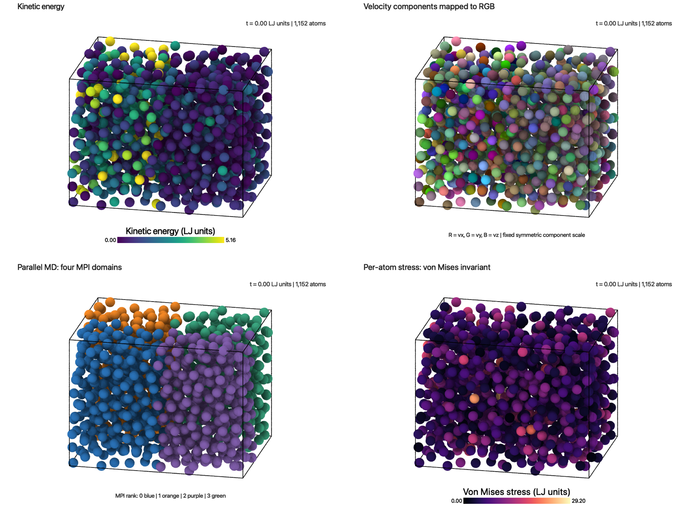
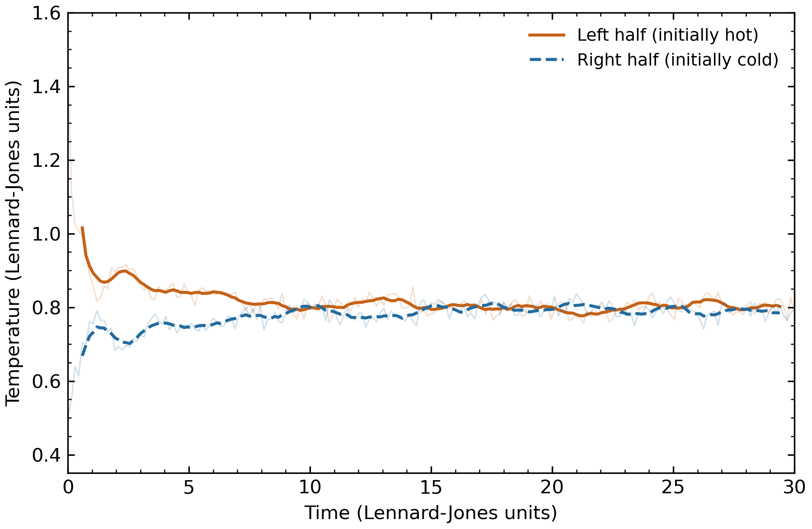
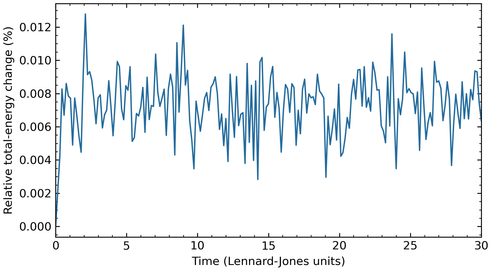

# Visualizing thermal equilibration in parallel molecular dynamics

Daniela Dantas Quintana · CSCI 596 · Final project: methods and results

This project extends the molecular-dynamics visualization ideas listed in Assignment 7. It simulates a periodic Lennard-Jones system with one initially hot spatial half and one initially cold half, then visualizes its kinetic energy, velocity components, MPI ownership, and per-atom stress in OVITO. All four views use the same computed trajectory.

## Question and scope

How does an initially nonuniform temperature field relax, and what additional information do velocity, domain, and stress views reveal about the same atomistic dynamics?

The four specific suggestions in Assignment 7 are implemented:

| Assignment suggestion | Implementation | Output |
|---|---|---|
| Color atoms by kinetic energy and demonstrate equilibration | Half-box temperature initialization; fixed energy color scale; regional temperature measurements | `movies/kinetic_energy.mp4`, `figures/temperature_evolution.png`, `figures/temperature_profile.png` |
| Map 3D velocities to the RGB cube | Signed velocity components mapped independently to red, green, and blue | `movies/velocity_rgb.mp4` |
| Animate parallel `pmd.c` | Actual four-rank MPI run, gathering resident atoms; persistent IDs survive migration | `movies/parallel_domains.mp4` |
| Visualize the 3×3 atomic stress tensor | All six independent components exported, with a von Mises invariant movie and six component maps | `movies/stress_von_mises.mp4`, `figures/stress_tensor_components.png` |

The dataset is generated by the hot/cold simulation described below.



## Methods

The starting point is the instructor's `pmd.c` and `pmd.h` from Assignment 4. Originals are preserved in `original/`, and changes in `src/` are enclosed by simple `MODIFIED` and `END MODIFIED` markers. The existing linked-cell forces, force-shifted Lennard-Jones potential, periodic boundaries, velocity-Verlet integration, and neighbor-exchange scheme are retained.

New code adds stable atom identifiers to the migration payload, computes per-atom pair virials at output steps, gathers only resident atoms to rank zero, and exports positions, velocities, kinetic energy, six symmetric stress components, and current MPI owner to a LAMMPS-format trajectory. The IDs ensure particles retain their identities when they move between ranks.

Parameters are in reduced Lennard-Jones units, with mass, Boltzmann constant, energy scale, and length scale set to one:

| Parameter | Value |
|---|---|
| Atoms | 1,152 |
| MPI grid | 2 × 2 × 1, four ranks on one compute node |
| Local FCC unit cells per rank | 4 × 3 × 6 |
| Global FCC unit cells | 8 × 6 × 6 |
| Number density | 0.8 |
| Force cutoff | 2.5 |
| Time step | 0.005 |
| Preparation | 2,000 NVE steps from the starter FCC configuration |
| Initial production temperature | 1.5 for x < Lx/2; 0.5 for x ≥ Lx/2 |
| Production | 6,000 steps; reduced time 30 |
| Output interval | 30 steps; 201 frames including step zero |
| Movie playback | 20 frames/s; 10.05 seconds per movie |

The preparation stage is a relaxation period, not a claim of a rigorously equilibrated ensemble. At the start of production, each spatial half's mean velocity is removed and its thermal velocities are rescaled once to the target temperature. There is no production thermostat, continuing rescaling, or external heat source. The two interfaces implied by periodic boundaries are retained. Temperatures are measured in fixed spatial halves, not in cohorts of atoms labeled hot or cold at the start.

Regional temperature is `T = sum_i |v_i - mean(v)|² / (3 N_region)`. Instantaneous regional streaming velocity is subtracted. The exported per-atom kinetic energy is `K_i = |v_i|²/2` and uses the actual velocity without this regional subtraction. Global temperature follows the starter's `2K/(3N)` convention; total momentum is effectively zero.

Following the Assignment 7 formula, the atomic tensor is

`sigma_i[a,b] = (N/V) [v_i[a] v_i[b] + 0.5 sum_(j != i) r_ij[a] F_ij[b]]`.

The force includes the starter program's cutoff force shift. The sign follows the handout's pressure-like convention, rather than the opposite Cauchy-stress sign used by some software. This is an equal-volume per-atom estimate with `N/V = density`, not a Voronoi-volume estimate. Its atom average gives the global kinetic-plus-virial stress. Stress components are in reduced energy/volume units.

The six stored components are xx, yy, zz, xy, xz, and yz; central pair forces make the tensor symmetric. The von Mises scalar is `sqrt(((xx-yy)²+(yy-zz)²+(zz-xx)²)/2 + 3(xy²+xz²+yz²))`. It is a visualization of deviatoric stress magnitude, not a claim of plastic yielding in this Lennard-Jones system.

All movie color bounds are fixed over the full trajectory. Energy and von Mises upper bounds use the global 99.5th percentile; signed stress component bounds are symmetric. Values beyond a bound saturate. For RGB, `Color[a] = clip(0.5 + v[a]/(2 v_limit), 0, 1)`, where the fixed `v_limit` is the global 99.5th percentile of absolute velocity components. Thus the RGB movie encodes components, including sign and magnitude; it is not a scalar speed map. Numeric bounds are saved in `results/visualization_ranges.json`.

## Actual results

The simulation completed on USC Discovery using four CPU cores on one node, with four MPI ranks. The [scheduler record](../results/final-accounting-13887119.txt) documents the completed run. This is a parallel simulation demonstration, not a scaling benchmark.

Initial spatial temperatures were **1.5 and 0.5**. Over reduced time **20–30**, the respective means were **0.799886 and 0.792648**, a mean difference of **0.007238**. The initial contrast largely disappears, while instantaneous finite-system fluctuations remain. The final temperature need not equal the initial average of 1.0: kinetic and potential energy exchange during NVE evolution.

Maximum total-energy deviation from the first production frame was **0.000393961 per atom**, or **0.012778%** of the initial energy magnitude. The run demonstrates relaxation in this finite system; it does not estimate thermal conductivity or establish convergence across system sizes or independent random seeds.



The temperature figure shows raw samples faintly and a nine-sample moving average as the main curves. This smooths fluctuations without changing the underlying CSV. The temperature profile uses 16 fixed spatial bins, subtracting each bin's instantaneous mean velocity.



## Verification

`results/verification.json` records the checks performed on the actual output:

- With visualization disabled, the modified program reproduces all four printed thermodynamic rows of the original code in the short baseline run. The reference uses the same four-rank header configuration; its C source is unchanged.
- All 201 frames have exactly 1,152 unique stable identifiers, finite fields, positions inside the periodic box, and MPI ownership consistent with the spatial decomposition. As many as 505 atoms have different owners from the first production frame.
- Exported kinetic energies and regional temperatures agree with independent recomputation from velocities to better than 1e-9. Total momentum stays below 1.7e-10 in magnitude per component in the exported trajectory.
- An independent NumPy all-pairs minimum-image calculation checks the potential energy and all six stress components at frames 0, 100, and 200. The maximum stress-component difference is 1.8e-8, and the potential-energy difference is below 1.7e-11 per atom.
- The relative energy deviation is below the chosen 0.1% acceptance bound.
- All four movies fully decode without errors: 201 frames, 20 fps, 10.05 seconds, 960 × 720 pixels. Beginning, middle, and final frames were visually inspected. Records are in `results/media-check/`.
- All four saved OVITO sessions were reopened in a fresh OVITO process and evaluated at frames 0, 100, and 200. RGB colors, MPI colors, and tensor-component mappings were checked numerically, with a tolerance appropriate for the float32 color storage.

These are numerical and reproducibility checks for this trajectory, not a general proof of the starter program for arbitrary input sizes.

## Reproduce

On Discovery, from the project root:

```bash
sbatch scripts/run.sl
```

The script loads GCC 13.3.0 and Open MPI 5.0.5, builds the modified and reference programs, performs the baseline comparison runs, and then runs production. It writes its build log, scheduler records, and source checksums to `results/`.

For analysis, Python needs NumPy and Matplotlib:

```bash
python scripts/verify.py
python scripts/analyze.py
```

For OVITO rendering, use the `ovitos` executable bundled with **OVITO Pro 3.16.1**:

```bash
ovitos scripts/render_ovito.py --preview
ovitos scripts/render_ovito.py
python scripts/compose_figures.py
```

The `ovitos` executable is supplied with the OVITO installation. The saved sessions in `ovito/` provide the four views for interactive exploration; if OVITO requests the data after relocating the folder, select `results/production/trajectory.dump` in the copied project. Sessions contain their Python modifier code. No GPU is required for the CPU simulation or Tachyon rendering.

## File guide

- `src/`: modified `pmd.c`, `pmd.h`, and new `visualization.h`.
- `original/`: unchanged instructor starter sources and checksums.
- `inputs/`: production and baseline input parameters.
- `scripts/`: run, verification, plotting, and rendering scripts.
- `results/production/`: real trajectory, standard output, and temperature/energy CSV.
- `results/`: verification, source diff, build log, rendering records, and scheduler records.
- `figures/`: previews, tensor component maps, and supporting plots.
- `movies/`: the four complete visualization movies.
- `ovito/`: saved interactive sessions.

## Sources

- Instructor's CSCI 596 Assignment 7 handout, “Final-Project Ideas”.
- Instructor's Assignment 4 `pmd.c` and `pmd.h`, preserved in `original/`.
- [Course visualization lecture](https://aiichironakano.github.io/cs596/VMD.pdf).
- [OVITO rendering documentation](https://www.ovito.org/manual/python/introduction/scripting/rendering.html).
- [OVITO Python modifier documentation](https://www.ovito.org/manual/python/modules/ovito_modifiers.html).
